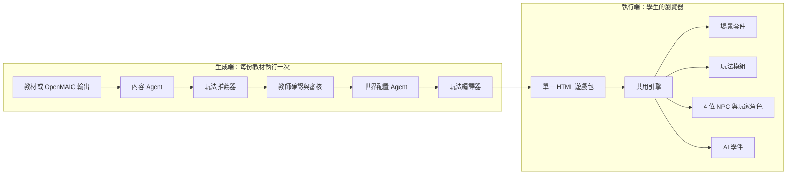

# OpenMAIC-GamePlay 項目說明書

> 為中學生而設的多智能體互動學習遊戲生成平台
> 文件版本：v1.1（2026 年 10 月 8 日）

### 版本記錄

| 版本 | 變更 |
|---|---|
| v1.0 | 初版：架構、資料合約、角色系統、三種玩法、推薦器 |
| v1.1 | 明確對象為中學生，移除所有企業培訓內容；範例改為校園題材；補入共用引擎、場景套件、三種玩法原型的開發成果與驗證發現 |

---

## 目錄

1. [項目概述](#1-項目概述)
2. [設計原則](#2-設計原則)
3. [系統架構](#3-系統架構)
4. [資料合約](#4-資料合約)
5. [角色系統](#5-角色系統)
6. [身份選擇系統](#6-身份選擇系統)
7. [AI 學伴](#7-ai-學伴)
8. [3D 場景系統](#8-3d-場景系統)
9. [玩法設計](#9-玩法設計)
10. [玩法推薦器](#10-玩法推薦器)
11. [執行模式與校內使用](#11-執行模式與校內使用)
12. [共用引擎與技術棧](#12-共用引擎與技術棧)
13. [原型開發紀錄](#13-原型開發紀錄)
14. [學生使用的安全與私隱](#14-學生使用的安全與私隱)
15. [風險與待決事項](#15-風險與待決事項)
16. [開發路線圖](#16-開發路線圖)
17. [術語表](#17-術語表)

---

## 1. 項目概述

### 1.1 一句話定位

OpenMAIC-GamePlay 讀取課程教材（或 OpenMAIC 處理後的結構化課程），自動生成**具強烈代入感的 3D 網頁學習遊戲**，讓中學生用手機或電腦瀏覽器直接遊玩，無需登入、無需安裝。

### 1.2 對象

| 角色 | 說明 |
|---|---|
| 學生（使用者） | 中學生，以香港中學文憑試（DSE）課程為起點，之後擴展至其他科目與年級 |
| 教師（操作者） | 上傳教材、確認玩法、審核內容、查看全班表現 |

### 1.3 要解決的問題

AI 教育工具已經能把教材整理成講義、簡報和測驗，但學生的體驗仍以閱讀和答題為主。學生缺少的是「身處其中、親自做決定、看見後果」的學習經驗。

市面上人手打造的教育遊戲質感高，卻無法規模化：每一篇課文都要從零設計，往往只能覆蓋課程的一小部分。

本項目的目標是讓**整套課程都能快速變成高質量的互動遊戲**，同時保證教學內容的準確性和遊戲的完成度。

### 1.4 與 OpenMAIC 的關係

OpenMAIC（Open Multi-Agent Interactive Classroom）是清華大學 THU-MAIC 團隊的開源項目，能把主題或文件轉化為多智能體互動課堂，本身已支援匯出互動網頁、小遊戲、模擬實驗等功能。

本項目定位為 OpenMAIC 的**下游延伸**，差異化在於：

- **完整的遊戲化敘事**：章節式劇情、身份選擇、固定角色陣容、結局回顧
- **成套的遊戲類型**：RPG 冒險、密室逃脫、3D 限時搬運
- **自動玩法推薦**：根據內容結構與教學用途，判斷最適合的遊戲形式

OpenMAIC 是可選的上游來源；系統同樣可以直接讀取原始教材。

### 1.5 市場參照

市面已有每篇課文人手打造的 3D 學習遊戲網站，以 DSE 範文為主，證明「網頁遊戲加 AI 學伴」的形式受學生接受。本項目只參考其**美術風格**與**「選擇身份」的代入手法**。

兩者的根本差異在於生產方式：人手打造只能覆蓋部分篇章，本項目以**範本加自動生成**覆蓋整套課程。

---

## 2. 設計原則

### 2.1 代入感是最高原則

| 要素 | 意思 | 系統中的實現 |
|---|---|---|
| 你是誰 | 學生一開始就有明確身份 | 身份選擇系統，NPC 以身份稱呼學生 |
| 你在哪裡 | 學生身處場景之中 | 3D 場景，而非答題介面 |
| 你的選擇有後果 | 決定即時反映在世界上 | 狀態值驅動天色、燈光、角色反應 |

### 2.2 一材多玩

同一份內容層可以生成三種玩法，也可以串成學習路徑。AI 只生成一次內容，換玩法時由程式規則轉換。

### 2.3 控制生成成本與品質

- **LLM 只用在必要的地方**：內容拆解和世界配置用 AI，玩法規則用程式
- **AI 負責配置，不負責建模**：3D 場景從套件挑選和參數化
- **分支收束**：選擇影響數值與結局，劇情不分裂成多條故事線
- **強約束輸出**：AI 輸出以 Schema 驗證，缺欄位即重新生成

### 2.4 錯誤也是學習

錯誤選項與誘餌來自內容中真實的**學習盲點**，每個錯誤都附帶針對性的解釋，結局時再完整回顧。

### 2.5 為手機而設計

學生主要以手機遊玩。所有介面以直向手機畫面為基準設計，再擴展至平板與電腦。

---

## 3. 系統架構

### 3.1 四層架構

| 層級 | 負責內容 | 產生方式 |
|---|---|---|
| 內容層 Content | 知識單元、盲點、測驗、身份、NPC 台詞、三級提示、結構標籤 | AI 生成（主要 LLM 成本所在） |
| 世界層 World | 場景套件、地點範本、道具類型、環境狀態、NPC 站位 | AI 從套件中挑選與配置 |
| 玩法層 Gameplay | RPG、密室逃脫、3D 搬運的具體規則 | 規則式編譯器（零 Token） |
| 表現層 Presentation | 3D 渲染、對話、角色動畫、學伴介面 | 共用引擎 |

### 3.2 生成端與執行端



### 3.3 遊戲狀態中心

執行端所有模組透過同一個狀態中心溝通：目前章節或回合、學生身份、狀態值、分數、作答紀錄、提示使用次數、被誘餌騙過的紀錄。成績回報、動態難度等外部功能都只需接入這一處。

---

## 4. 資料合約

生成端輸出三份 JSON，作為前後端之間的合約；另有一份推薦紀錄供教師檢視。

| 檔案 | 產生者 | 是否需要 LLM |
|---|---|---|
| `content.json` | 內容 Agent | 是 |
| `world.json` | 世界配置 Agent | 是（少量） |
| `game.json` | 玩法編譯器 | 否 |
| `recommendation.json` | 玩法推薦器 | 否 |

本章範例使用科學科「實驗室安全」作說明。

### 4.1 content.json 共通結構

| 欄位 | 說明 |
|---|---|
| `meta` | 主題、對象、中心論點、狀態值名稱與圖示 |
| `player_roles` | 可選身份（RPG 使用） |
| `npc_slots` | 4 個角色槽的外觀、名稱、個性、配件 |
| `units` | 知識單元陣列 |
| `endings`、`debrief` | 結局文字與導師總結 |

每個知識單元的共通欄位為 `unit_id`、`title`、`concept`、`key_quote`、`misconceptions`、`tags`、`hints`。各玩法另有專屬欄位：

| 玩法 | 單元專屬欄位 |
|---|---|
| RPG | `lines`（進場、引導、出招、提問）、`hotspots`、`choices`（三種固定類型）、`reactions`、`gate` |
| 3D 搬運 | `round_type`、`zones`、`items`（含答案與解釋）、`decoys` |
| 密室逃脫 | `station`、`puzzle_type`、`clues`（必要或誘餌）、`puzzle`、`reward`、`requires_item` |

**RPG 單元範例（節錄）**

```json
{
  "unit_id": "u1",
  "title": "化學品濺到眼睛",
  "concept": "化學品入眼，應立即用洗眼器以清水持續沖洗至少 15 分鐘，同時請同學通知老師。",
  "misconceptions": ["揉眼睛可以把化學品弄出來", "先找老師，再處理眼睛"],
  "tags": { "has_dilemma": true, "has_evidence": true, "has_perspectives": true, "bloom": "apply" },
  "lines": {
    "enter": "{address}，對面組的同學剛剛被溶液濺到眼睛了！",
    "guide": "化學品入眼，每一秒都重要。先沖洗，同時叫人通知老師。",
    "dilemma": "揉一揉就好啦，用手把它擦出來！",
    "prompt": "你會怎麼做？"
  },
  "choices": [
    { "type": "correct", "text": "立刻帶同學到洗眼器持續沖洗，同時請另一位同學通知老師", "feedback": "……" },
    { "type": "misconception", "text": "用手揉眼睛，把溶液擦出來", "feedback": "……" },
    { "type": "suboptimal", "text": "先跑去找老師，回來再沖洗", "feedback": "延誤沖洗會加重傷害。沖洗和通知應同時進行。" }
  ],
  "hints": {
    "dilemma": ["實驗室哪件設備是為這種情況而設？", "沖洗要多久？誰去通知老師？", "立即沖洗，同時請人通知老師。"],
    "gate": ["……", "……", "……"]
  }
}
```

**內容 Agent 的硬性生成規則**

- 每單元必須產出完整欄位，缺一即重新生成
- RPG 選項必須是三種固定類型；盲點選項與誘餌必須來自 `misconceptions`
- 3D 搬運的物件標籤不得超過 12 個中文字
- 密室每個機關至少 2 條必要線索、1 條誘餌線索
- 內容必須適合中學生閱讀，見第 14 章

### 4.2 world.json

世界配置只描述「用甚麼」和「放哪裡」，不包含任何模型或程式碼。

```json
{
  "scene_kit": "school_campus",
  "navigation": "guided",
  "stages": [
    {
      "unit_id": "u1",
      "template": "science_lab",
      "position": [0, 0, 0],
      "environment": { "time": "morning" },
      "hotspots": [
        { "id": "eyewash", "prop": "eyewash_station", "offset": [-1.3, 0, -1.3] },
        { "id": "label", "prop": "reagent_bottle", "offset": [1.0, 0, -1.6] }
      ]
    }
  ]
}
```

`template` 指定場景套件中的地點範本，`prop` 指定道具庫中的道具類型。新增題材時，只要套件中有合適的範本和道具，就不需要寫任何程式。

### 4.3 game.json

依玩法而不同，詳見第 9 章各玩法的設定範例。所有文字以引用方式指向 `content.json`。

---

## 5. 角色系統

### 5.1 角色槽與外觀分離

每個遊戲**固定有 4 個角色槽**，教學功能永遠不變；**外觀可替換**。

| 角色槽 | 教學功能 | 對應 OpenMAIC 資料 |
|---|---|---|
| `mentor` 導師 | 在故事中講解概念、事後點評 | AI 老師講稿 |
| `companion` 同伴 | 說出學生的疑問，示範思考 | AI 同學的提問 |
| `rival` 對手 | 以盲點製造兩難與誘餌 | 常見錯誤觀念 |
| `gatekeeper` 守門人 | 評量、決定能否前進 | 測驗題 |

對手的定位是「出難題的搗蛋鬼」，不是真正的壞人，最後會服輸。對手可以是課文中的人物（例如與主角辯論的一方）、擬人化的錯誤觀念，或場景中的訊息與聲音。

### 5.2 預設外觀：G、O、A、I

| 角色 | 造型特徵 | 預設角色槽 | 理由 |
|---|---|---|---|
| G（橙） | 帶向上箭頭的環形 | `mentor` | 箭頭象徵指路 |
| O（綠） | 圓環、身體傾斜 | `companion` | 姿態活潑，像好奇的同學 |
| A（藍） | 尖頂三角形 | `rival` | 尖角最有搗蛋感 |
| I（黃） | 直立長方形 | `gatekeeper` | 形似門或柱，天生守關 |

另有一個**玩家角色**（粉紅色圓角長方形），在需要學生親自走動的玩法中使用，同樣符合角色規格書。

### 5.3 換裝系統

固定外觀透過配件演出不同身份，角色辨識度不變，主題感靠配件呈現。目前引擎支援的配件：

| 配件 | 效果 | 典型用途 |
|---|---|---|
| `ru_hat` | 儒冠 | 古代老師、思想家 |
| `coin` | 胸前錢幣 | 以利誘人的角色 |
| `lantern` | 浮空燈籠，亮度隨狀態值變化 | 古代場景的守門人 |
| `beacon` | 頭頂警示燈，隨狀態值由紅轉綠 | 現代場景的守門人 |
| `tie` | 領帶 | 現代場景的老師 |
| `hood` | 兜帽 | 神秘或搗蛋角色 |

四個角色都**沒有手**，配件只能放在頭頂、身體正面或浮在身旁。

### 5.4 角色規格書

| 部件 | 要求 |
|---|---|
| 身體 | 獨立網格，正面朝 +Z，底部在原點 |
| 眼睛 | 左右各兩件：眼白與瞳孔，瞳孔可在眼白範圍內平移 |
| 腿 | 左右兩條獨立部件，軸心在髖部 |
| 配件錨點 | 頭頂、身體正面、身旁浮空點 |
| 面數 | 單一角色 2 萬面以內 |
| 格式 | 由向量圖程序生成，或 glTF |

### 5.5 程序動畫

符合規格書的角色，以下動畫全部由引擎自動驅動，不需要骨架：眼睛追蹤（看著學生、說話的角色或目標物件）與隨機眨眼；雙腿正弦擺動的走路循環；說話時的壓扁拉伸；跳起、搖晃、垮下三種情緒反應。

### 5.6 STL 素材評估

原始 STL 檔每個約 97 MB、約 195 萬面，屬 3D 列印用途，沒有顏色、部件融為一體，無法直接用於網頁。四個角色已改以程式從圖形擠出重建，部件天然分離、每個角色只有數千面。

---

## 6. 身份選擇系統

學生開局選擇身份，同一套知識從不同立場切入。不同身份共用同一套章節結構，差異在於起始狀態值、NPC 的稱呼與說話方式、探索熱點揭露資訊的角度，以及角色槽由哪些劇中人物填上。

| 題材類型 | 身份 A | 身份 B |
|---|---|---|
| 史論類課文 | 選擇其中一國，以該國處境做決策 | 選擇另一國，面對不同壓力 |
| 論說類課文 | 身處困境的讀書人 | 初出茅廬的少年 |
| 科學實驗 | 組長：負責判斷與分工 | 記錄員：負責觀察與記錄 |

結局「揭盅」把學生的選擇與正確推理（或作者的論點）並排對照，並提供換身份重玩的入口。

---

## 7. AI 學伴

### 7.1 與導師的分工

| | 導師（`mentor`） | AI 學伴 |
|---|---|---|
| 位置 | 故事之內 | 故事之外，陪在學生身邊 |
| 何時出現 | 劇情固定節拍 | 學生需要時 |
| 做甚麼 | 講解概念、點評選擇 | 給分級提示 |

### 7.2 三級提示

每個抉擇、守門題、回合與機關都在生成時預先產生三級提示：指方向、縮小範圍、接近答案。

### 7.3 觸發與代價

| 玩法 | 代價 | 呈現方式 |
|---|---|---|
| RPG | 每次扣 2 分 | 文字提示 |
| 密室逃脫 | 每次扣 3 分 | 文字提示，依目前機關而定 |
| 3D 搬運 | 每次扣 5 秒 | 視覺提示：答案區閃爍、正確物件發光、標出誘餌 |

被動觸發：閒置過久時提醒操作方法；同一題連續答錯時自動給第一級提示（不扣分）。

### 7.4 靜態與即時

| | 靜態模式 | 即時模式 |
|---|---|---|
| 提示來源 | 預先生成 | LLM 依學生狀態即時生成 |
| 自由對話 | 不支援 | 支援 |
| 連線 | 可離線 | 需要後端 |
| 成本 | 零 | 每次遊玩產生費用 |
| 定位 | 預設 | 進階功能，需學校啟用 |

即時模式的硬性規則：**三級提示用完之前，絕不直接說出答案**；所有輸出需經內容安全過濾（見第 14 章）。

---

## 8. 3D 場景系統

### 8.1 策略：場景套件加道具庫

不由 AI 從零生成 3D 場景。每個場景套件包含三部分：

| 部分 | 內容 |
|---|---|
| 環境預設 | 時間、天色、光線（例如清晨、黃昏、陰天、夜晚） |
| 地點範本 | 一組佈置好的地點（例如市集、茶亭、課室、實驗室） |
| 道具庫 | 可放置的互動道具（例如竹簡、水缸、洗眼器、試劑瓶） |

世界配置 Agent 只負責挑選範本與道具、決定位置和環境狀態。

### 8.2 套件規劃

| 套件 | 狀態 | 適用題材 |
|---|---|---|
| 古代場景（市集、茶亭、村口、宅第） | 已完成 | 古文、歷史 |
| 杏壇庭院（搬運玩法競技場） | 已完成 | 古文、語錄 |
| 古代庫房（密室） | 已完成 | 寓言、哲理 |
| 現代校園（課室、圖書館、操場、實驗室） | 待製作 | 白話文、科學、公民與社會發展 |

### 8.3 環境狀態與後果呈現

狀態值下降時場景變暗、色彩轉冷；做出好選擇時暖光閃現，錯誤時以暗色閃現。密室逃脫中，房間起初昏暗，每破解一個機關就亮一些。

### 8.4 美術方向

溫暖、帶插畫感的風格化 3D，低多邊形加卡通著色。

### 8.5 效能預算

| 項目 | 目標 |
|---|---|
| 單一場景面數 | 10 萬面以內 |
| 單一角色面數 | 2 萬面以內 |
| 遊戲包大小 | 單一 HTML，建議 5 MB 以內（目前原型約 60 KB，另載入 three.js） |
| 目標裝置 | 中階手機瀏覽器 |
| 陰影 | 以圓形假陰影代替即時陰影 |

---

## 9. 玩法設計

### 9.1 RPG 冒險

**定位**：決策與後果。不計時，一局 10 至 20 分鐘。

**結構**：序章（選身份、認識角色）→ 3 至 5 章 → 結局揭盅。採用分支收束。

**每章六個固定節拍**

| 節拍 | 內容 | 主角 | AI 學伴 |
|---|---|---|---|
| 1. 進場 | 鏡頭帶到新地點，同伴描述狀況 | `companion` | 不出現 |
| 2. 探索 | 點擊 2 至 3 個熱點取得資訊 | 學生 | 閒置時提醒 |
| 3. 引導 | 導師整理成概念 | `mentor` | 不出現 |
| 4. 出招 | 對手以盲點製造兩難 | `rival` | 可求助 |
| 5. 抉擇與後果 | 三選一，場景與數值即時變化 | 全體 | 解釋選擇 |
| 6. 守門 | 知識題，精熟制 | `gatekeeper` | 答錯時給提示 |

三個選項類型固定：正確、盲點、看似合理但不夠好；順序每次隨機。狀態值影響環境與結局，分數記錄學習表現，兩者分開。

```json
{
  "mode": "rpg",
  "state": { "meter": { "label": "安全指數", "min": 0, "max": 100 } },
  "scoring": { "gate_first_try": 10, "gate_wrong_penalty": 3, "hint_penalty": 2, "gate_min": 2 },
  "chapters": [
    {
      "unit_id": "u1",
      "beats": {
        "explore": { "hotspots": ["eyewash", "label"], "require_all": true, "idle_hint_sec": 25 },
        "choices": [
          { "type": "correct", "meter": 15, "score": 10 },
          { "type": "misconception", "meter": -20, "score": 0 },
          { "type": "suboptimal", "meter": -8, "score": 5 }
        ],
        "gate": { "speaker": "gatekeeper", "mastery": true }
      }
    }
  ],
  "endings": [
    { "id": "best", "min_meter": 80 },
    { "id": "normal", "min_meter": 50 },
    { "id": "fail", "min_meter": 0 }
  ]
}
```

### 9.2 密室逃脫

**定位**：觀察與推理。一局 15 至 20 分鐘，不限時，顯示用時。

**結構**：一個房間、3 至 5 個機關。半開放解鎖：開局可挑戰部分機關，破解後解鎖其他機關或取得所需物品。每個機關需先找齊附近的必要線索。破解所有機關得到密碼字，按正確次序放入石門，再回答守門人的綜合題。

**機關範本**

| 範本 | 玩法 | 介面 |
|---|---|---|
| 線索拼湊 | 綜合多條線索推出結論 | 選擇題 |
| 真假辨識 | 從相似的選項中找出真的 | 選擇題 |
| 配對 | 為每一格配上正確的牌子 | 逐列選擇標籤 |
| 順序 | 依正確次序撥動機關 | 點選排序，含一個干擾項 |
| 密碼排列 | 把收集的字按次序放入 | 點選排序 |

**三種線索**：必要線索、誘餌線索（對手留下，內容來自盲點，外觀與其他線索完全相同）、背景線索。結局列出學生被哪些誘餌騙過，直接診斷其錯誤觀念。

**專屬機制**：線索自動記入筆記本；物品欄；答錯冷卻 5 秒；同一機關錯 3 次自動給第一級提示；同伴每個機關可協助找一條線索。

### 9.3 3D 限時搬運

**定位**：熟練與反應。一局 5 至 8 分鐘，3 至 5 個 30 至 90 秒的回合，重玩價值最高。

**核心循環**：看題目 → 點擊竹簡撿起 → 點擊答案區放下 → 守門人即時驗收。一次只能搬一件。

| 回合 | 答案區 |
|---|---|
| 分類 | 2 至 4 個類別區 |
| 配對 | 刻有題目的底座，每個只收一件 |
| 排序 | 編號格子 |
| 單選 | 一個祭台 |

**角色分工**：導師開局說明任務；同伴每回合可代搬一件；對手定時投放誘餌，沒有誘餌的回合則把離學生最近的物件踢走；守門人驗收，錯放時物件彈回並顯示解釋。

**計分**：答對 10 分，連擊額外加分；錯放扣 5 分；提前完成有時間獎勵；每回合 0 至 3 星；最後錯題回放。

**手機版面**：直向畫面自動改為兩欄物件、2×2 答案區、較高的俯視鏡頭，避免標籤重疊。

### 9.4 三種玩法總覽

| 項目 | RPG 冒險 | 密室逃脫 | 3D 限時搬運 |
|---|---|---|---|
| 訓練目標 | 決策與後果 | 觀察與推理 | 熟練與反應 |
| 一局時間 | 10 至 20 分鐘 | 15 至 20 分鐘 | 5 至 8 分鐘 |
| 計時 | 否 | 顯示用時 | 每回合倒數 |
| 對手的作用 | 製造兩難 | 留下誘餌線索 | 投放誘餌、踢走物件 |
| 守門人形式 | 每章一題 | 石門綜合題 | 答案區即時驗收 |
| 提示代價 | 扣分 | 扣分 | 扣時間 |
| 結局回顧 | 決策時間線 | 被騙過的誘餌 | 錯題回放 |

### 9.5 學習路徑

三種玩法可以串成一條路徑：RPG 建立情境與動機 → 密室逃脫練習推理 → 搬運反覆鞏固。同一份 `content.json` 驅動多個章節，教師從作答紀錄看出學生卡在哪一個環節。

---

## 10. 玩法推薦器

### 10.1 流程

1. **貼標籤**：內容 Agent 為每個單元標記結構標籤與認知層次
2. **硬性篩選**：不符合最低要求的玩法直接排除
3. **計分**：結合內容因素與教學情境
4. **輸出推薦**：主要推薦、理由、被排除的玩法與原因，由教師確認或改選

### 10.2 結構標籤

| 標籤 | 意思 |
|---|---|
| `has_dilemma` | 有兩難抉擇，不同做法有不同後果 |
| `has_perspectives` | 可從不同立場或身份切入 |
| `has_evidence` | 需要從證據推出結論 |
| `has_categories` | 可以分類 |
| `has_sequence` | 有固定步驟或先後次序 |
| `has_pairs` | 有一對一對應關係 |
| `short_labels_ok` | 關鍵詞可濃縮至 12 字以內 |

認知層次：記憶與理解 → 搬運；應用與分析 → 密室逃脫；評鑑與決策 → RPG。

### 10.3 硬性條件

| 玩法 | 最低要求 |
|---|---|
| RPG | 至少 3 個單元，且大部分有 `has_dilemma` |
| 密室逃脫 | 至少 3 個單元有 `has_evidence`，每單元 2 條以上必要線索 |
| 3D 搬運 | 具分類、排序或配對結構，且 `short_labels_ok`，每回合至少 6 個物件 |

### 10.4 教學情境

| 教師的用途 | 偏向玩法 |
|---|---|
| 新課引入 | RPG |
| 理解後練習 | 密室逃脫 |
| 考前溫習 | 3D 搬運 |
| 課堂評估 | 3D 搬運（評估模式）或密室逃脫 |

| 可用時間 | 影響 |
|---|---|
| 少於 10 分鐘 | 只推薦 3D 搬運 |
| 10 至 20 分鐘 | 三種皆可 |
| 一整節課以上 | 推薦學習路徑 |

### 10.5 推薦器的實測結果

以一整套中文科指定範文測試推薦器，觀察到：

- **論說類、史論類**範文多含兩難抉擇，推薦 RPG
- **語錄類、對比類**範文有清晰的分類與配對結構，推薦 3D 搬運
- **寓言類**範文圍繞「同一物件、不同用法」，是少數通過密室逃脫門檻的類型
- **寫景抒情類**範文在三種玩法中適配度都偏低，揭示了框架的缺口（見第 15 章）

三種推薦結果其後都以原型實作驗證，玩法與內容結構的配合符合預期。

---

## 11. 執行模式與校內使用

### 11.1 交付形式

遊戲以**單一自足的 HTML 檔**交付，可以發佈為網址、嵌入學校學習平台，或離線開啟。學生無需登入、無需安裝。

### 11.2 校內使用情境

| 情境 | 建議玩法 | 方式 |
|---|---|---|
| 課堂開始，引入新課 | RPG | 全班同時遊玩，結束後討論結局揭盅 |
| 課後練習 | 密室逃脫 | 學生自行完成，教師查看誘餌紀錄 |
| 考前溫習 | 3D 搬運 | 反覆遊玩刷分，鞏固記憶 |
| 小測 | 3D 搬運評估模式 | 回合結束才揭曉答案 |

### 11.3 成績回報（規劃中）

如需把成績回傳至學校的學習管理平台，可採用 xAPI 或 SCORM 規格打包。成績與作答紀錄由遊戲狀態中心輸出。

### 11.4 教師端（規劃中）

- 上傳教材、填寫用途與時間
- 檢視與修改 `content.json`，特別是選項、盲點、提示和解釋
- 確認推薦玩法
- 查看全班作答統計：最常答錯的題目、最常被騙的誘餌

---

## 12. 共用引擎與技術棧

### 12.1 檔案結構

```
engine/
  engine.js        共用引擎：渲染、材質、環境、角色與程序動畫、
                   鏡頭、3D 錨定標籤、對話、學伴氣泡、疊層介面
  kit_*.js         場景套件：環境預設、地點範本、道具庫
  rpg.js           RPG 玩法模組
  carry.js         3D 搬運玩法模組
  escape.js        密室逃脫玩法模組
shells/
  *_shell.html     各玩法的頁面外殼（版面、樣式、HUD）
build              把三份 JSON、引擎、套件、玩法模組
                   內嵌成單一 HTML
```

玩法模組只寫自己的規則，不包含渲染或角色程式碼；場景完全由套件提供。新增玩法或套件時，引擎無需修改。

### 12.2 技術選擇

| 範疇 | 選擇 | 備註 |
|---|---|---|
| 3D 引擎 | Three.js r128 | 由 CDN 載入 |
| 角色與場景 | 程序生成幾何 | 卡通著色、低多邊形 |
| 前端 | 原生 HTML/CSS/JS | 單檔自足 |
| 生成端後端 | Python 或 TypeScript | 若需整合 OpenMAIC，TypeScript 較順 |
| 結構驗證 | Pydantic 或 Zod | 強約束 AI 輸出 |
| 測試 | 無頭瀏覽器自動通關 | 桌面與手機兩種畫面 |

### 12.3 自動化測試

每個原型都以無頭瀏覽器執行自動通關測試：機器人讀取 `content.json`，依正確答案操作（並刻意答錯一次以測試錯誤流程），在桌面與手機畫面各跑一次完整流程，並截圖檢查版面。

---

## 13. 原型開發紀錄

### 13.1 已完成的原型

| 原型 | 玩法 | 課文類型 | 場景套件 | 驗證重點 |
|---|---|---|---|---|
| 一 | RPG | 論說類範文 | 古代場景 | 完整管線、六節拍、身份選擇、結局揭盅 |
| 二 | 3D 搬運 | 語錄類範文 | 杏壇庭院 | 四種回合、誘餌、連擊、共用引擎首次使用 |
| 三 | 密室逃脫 | 寓言類範文 | 古代庫房 | 五種機關範本、半開放解鎖、誘餌診斷 |
| 四 | RPG | （技術驗證） | 第二套件 | RPG 遷移到共用引擎、套件與道具庫架構、換皮 |

### 13.2 主要發現

**玩法與內容高度貼合**：三篇不同類型的課文各自對應一種玩法，推薦器的判斷在實作中得到印證。

**誘餌設計有效**：誘餌線索與錯誤選項都來自真實盲點，例如以現代詞義解讀文言字詞、把對話雙方的話張冠李戴、看到關鍵字就分類。這些正是學生最常犯的錯，也讓錯題回顧具體可用。

**密碼可以承載主旨**：密室逃脫中，集齊的字按次序排列就是全文主旨，學生在破解的最後一刻親手拼出中心思想。

**共用引擎成立**：搬運和密室完全沒有修改引擎；第二套件加入時，引擎只新增了配件類型與可指定顏色的閃光。

**手機版面需要專門設計**：直向畫面必須重新安排物件欄數、答案區排列和鏡頭角度，不能只是縮小桌面版。

---

## 14. 學生使用的安全與私隱

| 項目 | 原則 |
|---|---|
| 登入與個人資料 | 學生無需登入；靜態模式不收集任何個人資料 |
| 作答紀錄 | 只在學生的瀏覽器內保存；如需回報成績，由學校平台處理 |
| 內容適齡 | 所有生成內容須適合中學生；涉及衝突、危險的情境以教育為目的，避免血腥或令人不安的描寫 |
| 角色塑造 | 對手是「搗蛋鬼」，不把真實群體或職業塑造成反派 |
| 即時模式 | LLM 輸出必須經內容安全過濾，並限制在課程範圍內 |
| 教師審核 | 正式使用前，教師必須審核內容，特別是課文詮釋與知識準確性 |

---

## 15. 風險與待決事項

| 項目 | 說明 | 建議行動 |
|---|---|---|
| OpenMAIC 授權 | 公開資料對其授權說法不一（AGPL-3.0 或 MIT） | 直接確認 repo 的 LICENSE；若為 AGPL，避免修改其程式碼，或洽商授權 |
| OpenMAIC 輸出格式 | 尚未取得實際課程輸出 | 實際跑一次並取得輸出，再設計膠水層 |
| 內容準確性 | AI 對課文的詮釋可能有偏差 | 教師審核為必要環節 |
| 寫景抒情類課文 | 三種玩法都不太適合 | 評估第四種「探索漫遊」模式 |
| 現代題材 | 目前套件以古代場景為主 | 製作現代校園套件 |
| 即時模式成本 | 每次遊玩都有 LLM 費用 | 預設靜態模式 |
| 手機效能 | 低階手機可能卡頓 | 嚴守效能預算，提供低畫質模式 |
| 語音 | 尚未支援配音 | 評估 TTS，粵語與普通話優先 |

---

## 16. 開發路線圖

### 階段一：概念驗證（已完成）

- [x] 四層架構與資料合約
- [x] 三種玩法設計與推薦器規則
- [x] 完整管線跑通，產出第一個可玩原型

### 階段二：三玩法原型（大部分完成）

- [x] 共用引擎 `engine.js`
- [x] 3D 搬運原型（四種回合類型）
- [x] 密室逃脫原型（五種機關範本）
- [x] RPG 遷移到共用引擎
- [x] 場景套件與道具庫架構
- [ ] 現代校園場景套件，以學生題材驗證
- [ ] 生成端 Schema 與自動重試

### 階段三：自動化管線

- [ ] 生成端服務：上傳教材 → 自動產出遊戲包
- [ ] 推薦器上線，含教師確認介面
- [ ] 教師端內容審核與修改介面

### 階段四：課堂與生態

- [ ] 對接 OpenMAIC 輸出（視授權確認結果）
- [ ] 成績回報（xAPI 或 SCORM）
- [ ] 全班作答統計
- [ ] 即時模式：LLM 學伴、語音
- [ ] 動態難度與學生數據驅動的推薦
- [ ] 探索漫遊模式

---

## 17. 術語表

| 術語 | 解釋 |
|---|---|
| 內容層 | 由 AI 從教材拆解出的結構化教學內容 |
| 知識單元 | 一個獨立知識點，對應一章、一個機關或一個回合 |
| 盲點 | 學生常見的錯誤觀念，用作錯誤選項與誘餌的來源 |
| 誘餌 | 由對手放出、來自盲點的錯誤物件或線索 |
| 角色槽 | 4 個固定的 NPC 教學功能位置 |
| 外觀 | 填入角色槽的角色模型，可替換 |
| 狀態值 | 反映學生選擇累積後果的數值，名稱依題材而定 |
| 節拍 | RPG 每章固定的六個流程步驟 |
| 精熟制 | 答錯不擋關，提示後重答直到答對，但分數遞減 |
| 揭盅 | 結局時把學生選擇與正確推理並排對照 |
| 分支收束 | 選擇只影響數值與結局，劇情回到主線 |
| 場景套件 | 包含環境預設、地點範本與道具庫的 3D 素材組合 |
| 道具庫 | 套件中可由 `world.json` 直接指定的互動道具 |
| 共用引擎 | 三種玩法共用的渲染、角色、介面基礎程式 |
| 學習路徑 | 同一內容依序以多種玩法呈現，從理解走到熟練 |
